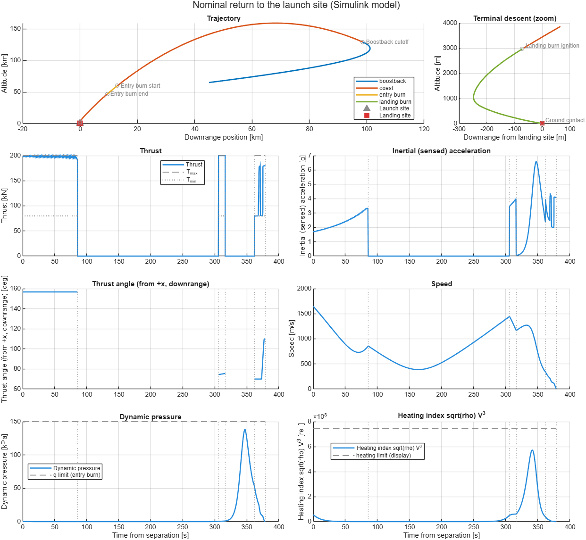
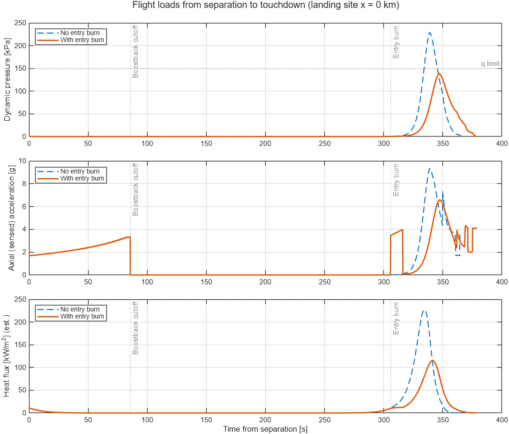
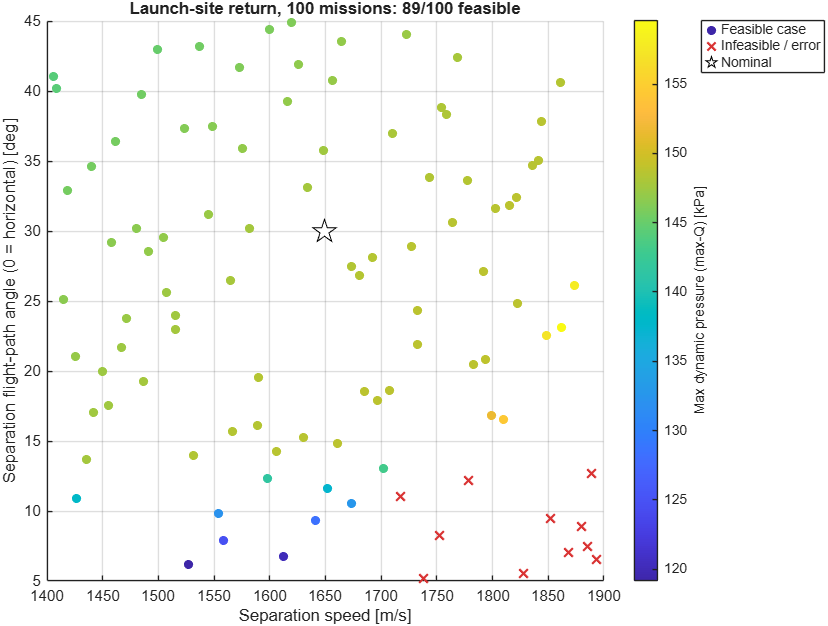

# Reusable Booster Return — Convex-Optimization Guidance in MATLAB/Simulink

A MATLAB/Simulink simulation of a reusable first stage flying back after
stage separation and landing propulsively: **boostback burn → ballistic
coast with drag → entry burn → landing burn → touchdown**. Each burn is
guided by an onboard-style algorithm built on **convex optimization**
(second-order cone programming), the approach behind the G-FOLD family of
powered-descent guidance algorithms.



*Nominal return to the launch site, flown in the Simulink model: trajectory
coloured by flight phase with a zoom on the landing burn (the last 3 km),
thrust with engine limits, inertial load,
thrust angle, speed, dynamic pressure and heating, each with its limit.*

## Results at a glance

Nominal mission (return to the launch site), Simulink model:

| | |
|---|---|
| Separation | 65 km altitude, 45 km downrange, 1649 m/s at 30° |
| Boostback burn | 85.6 s, 6.1 t propellant; apogee 159 km |
| Entry burn (60 km) | 10.4 s, 0.75 t — cuts max-Q from 229 to **139 kPa** (limit 150) |
| Peak loads | 6.6 g axial (9.3 g without the entry burn); ~115 kW/m² stagnation heat flux (est.) |
| Landing burn | ignites at 3 km and 344 m/s; re-planned every second |
| **Touchdown** | **0.83 m/s, on the pad**, 435 kg of propellant left |

## How it works

| Phase | Guidance | Method |
|---|---|---|
| Boostback | Minimum-fuel burn that puts the stage on a ballistic arc ending at the landing-burn ignition point | **Lossless-convexified SOCP** (Açıkmeşe & Ploen change of variables), solved with `coneprog`; affine coast constraint keeps it convex; free burn time by 1-D search. Aimed with a **predictor-corrector bias loop** that accounts for drag and the entry burn. |
| Entry burn | Smallest retrograde burn that keeps peak dynamic pressure (and optionally heating) within limits | **Numerical predictor + root finding**, sized in flight from the measured state at 60 km, with a design margin for model error. |
| Landing burn | Minimum-fuel landing on the pad at zero velocity, with thrust bounds, 20° tilt limit and glide-slope cone | **Successive convexification (SCvx)**: drag in the dynamics, virtual control, trust region, free burn time via time dilation. **Re-planned in flight** every second from the measured state (warm-started), planning with a 10 % thrust reserve. |

**Guidance model vs. plant.** The guidance predicts with its own simplified
onboard model (an atmosphere table), while the simulated "truth" uses the
COESA 1976 standard atmosphere and a Mach-dependent drag coefficient. The
mismatch is deliberate: it is what makes closed-loop re-planning necessary.
Flown open-loop, the same landing plan hits the ground at ~98 m/s; with
in-flight re-planning it touches down below 1 m/s.

**Simulink model.** `simulink/booster_return_3dof.slx` is built from
**native blocks** (integrators, products, lookup tables, the Aerospace
Blockset COESA atmosphere), so the diagram itself shows the physics. It is
**generated by a script** (`simulink/build_model.m`) for reproducibility.
The in-flight guidance runs in MATLAB Function blocks (entry-burn sizing in
a Triggered Subsystem; landing guidance at 10 Hz), and their plans are flown
by native blocks as thrust = commanded acceleration × current mass.

**Two implementations.** A plain-MATLAB version of the same mission
(`sim/run_open_loop_demo.m`) is kept as an independent cross-check: the two
agree to ~0.3 m at landing-burn ignition and to 0.02 m/s at touchdown.

## Flight loads and Monte Carlo analysis



*Dynamic pressure, axial (sensed) acceleration and stagnation heat flux along
the nominal mission, with and without the entry burn.*

The Monte Carlo framework (`montecarlo/`) disperses chosen parameters
(seeded Latin-hypercube sampling), flies **every sample through the
Simulink model**, and analyses feasibility, sensitivities (rank
correlations) and output distributions. Flight loads — max-Q, axial load
factor, heating — are recorded for every mission.



*100 launch-site returns with dispersed separation speed (±15 %) and
flight-path angle (5–45°), coloured by max-Q. Crosses: no feasible
boostback (too much horizontal speed to reverse with the propellant on
board). Run of 2026-10-25, before the landing guidance and the onboard
atmosphere table were integrated; to be re-run.*

## Getting started

**Requirements:** MATLAB with Simulink, Optimization Toolbox (`coneprog`),
Aerospace Toolbox and Aerospace Blockset. Developed on R2026a.

```matlab
run simulink/run_and_plot.m      % fly the nominal mission in Simulink, save it, plot it
plot_flight_record()             % re-plot the most recent saved flight (no simulation)
run sim/run_open_loop_demo.m     % the same mission in the plain-MATLAB implementation
runtests('tests')                % 49 unit tests
```

After structural changes to the model, regenerate it with
`run simulink/build_model.m`.

**Running and plotting are decoupled.** Every run saves a self-describing
*flight record* to `results/flights/` (signals with units, limits, events,
flight phase, parameters, code version); plots are drawn only from these
files. Choose panels with
`plot_flight_record(file, Panels=["thrust" "mach" "heatFlux"])`. A new
variable is one entry in `sim/flight_signal_defs.m`.

**Main parameters** live in `params/vehicleParams.m`: vehicle, separation
state, landing site (`p.target.x`: 0 = launch site, large values =
downrange droneship), guidance settings and limits.

**Monte Carlo:** edit and run `montecarlo/run_mc_mission.m` (for long runs,
use a separate process: `matlab -batch "run('montecarlo/run_mc_mission.m')"`).

**Studies:** `study_drag_effect`, `study_entry_burn` (cost vs. load limits),
`study_flight_loads`, and `sim/validate_falcon_heavy.m` (real-scale
feasibility check with public Falcon Heavy side-booster data).

## Repository structure

```
params/      vehicle, environment and guidance parameters
dynamics/    equations of motion, drag model, ODE events (MATLAB plant)
guidance/    boostback SOCP + targeting, entry-burn sizing, SCvx landing
             guidance, onboard atmosphere and guidance model
simulink/    the Simulink model, the script that generates it, run_and_plot
sim/         mission entry point (simulate_mission), MATLAB implementation,
             flight records and plotting, studies
montecarlo/  dispersion catalog, sampling, runner, analysis
tests/       matlab.unittest tests
docs/images/ figures used in this README
results/     generated data (not version-controlled)
```

## Assumptions and limitations

- **Planar point-mass model** (3 states of motion + mass): no attitude
  dynamics, flat Earth, constant gravity, no wind. Thrust direction is
  assumed achievable instantly.
- **Illustrative vehicle**: a small stage (4 t dry, 8 t propellant at
  separation, one 200 kN engine, 1.5 m diameter). Parameters and the drag
  curve are order-of-magnitude values, not a real vehicle's data.
- Heat flux is a Sutton–Graves estimate with an assumed nose radius: an
  order-of-magnitude indicator, not a thermal analysis.
- In-flight guidance runs as MATLAB code inside the Simulink blocks
  (normal-mode simulation, not code-generation ready); a re-plan takes
  ~1–3 s of computation, so a full mission takes about a minute to simulate.

## Roadmap

- Re-run the Monte Carlo with the landing guidance; realistic dispersions
  (mass, thrust, drag, density, wind) and landing-accuracy statistics.
- Attitude dynamics with a cascaded attitude controller (guidance outputs a
  thrust direction; an inner loop turns it into a pitching moment).
- Faster re-plans (iteration caps, fewer nodes late in the burn).
- Drag inside the boostback optimizer (successive convexification).

## References

- B. Açıkmeşe, S. R. Ploen, "Convex Programming Approach to Powered Descent
  Guidance for Mars Landing", *J. Guidance, Control, and Dynamics*, 2007.
- L. Blackmore, B. Açıkmeşe, D. P. Scharf, "Minimum-Landing-Error Powered-
  Descent Guidance for Mars Landing Using Convex Optimization", *JGCD*, 2010.
- Y. Mao, M. Szmuk, B. Açıkmeşe, "Successive Convexification of Non-Convex
  Optimal Control Problems and Its Convergence Properties", *IEEE CDC*, 2016.
- D. Malyuta et al., "Convex Optimization for Trajectory Generation",
  *IEEE Control Systems Magazine*, 2022.
- H. J. Allen, A. J. Eggers, NACA Report 1381, 1958 (ballistic entry).
- K. Sutton, R. A. Graves, NASA TR R-376, 1971 (stagnation heating).

## Author

Mauro Madrid — portfolio project in guidance, navigation & control.

Developed with the help of an AI coding assistant (Claude Code) in a
pair-programming style: the design decisions, direction and review of
results are the author's.
